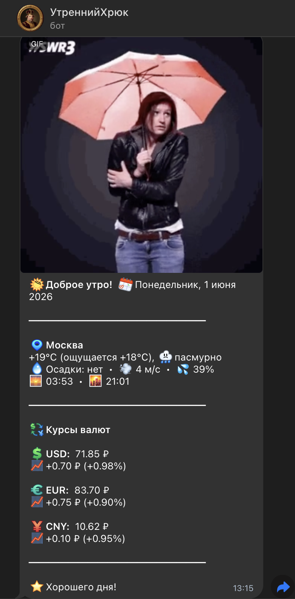
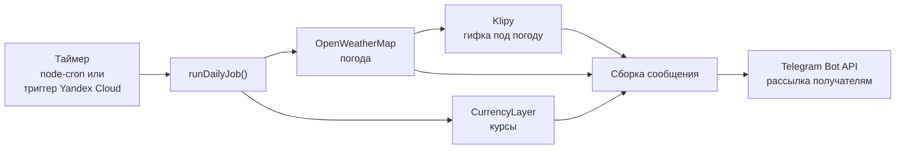

<p align="center">
  
</p>

<h1 align="center">Morning Bot</h1>

<p align="center">
  <b>Утренняя сводка в Telegram: погода, курсы валют и гифка под настроение — каждый день в одно и то же время.</b>
</p>

<p align="center">
  
  
  
  <a href="https://github.com/dekciw/morningbot/releases/latest"></a>
  <a href="https://t.me/kabanes_info_bot"></a>
  <a href="LICENSE"></a>
</p>

<p align="center">
  <a href="https://t.me/kabanes_info_bot">
    
  </a>
</p>

<p align="center">
  <a href="https://t.me/kabanes_info_bot">Демо</a>
  ·
  <a href="https://github.com/dekciw/morningbot/issues/new?labels=bug">Сообщить об ошибке</a>
  ·
  <a href="https://github.com/dekciw/morningbot/issues/new?labels=enhancement">Предложить идею</a>
</p>

<br>

<table align="center">
  <tr>
    <td width="50%" valign="top">
      
    </td>
    <td width="50%" valign="top">
      <h3>Что приходит утром</h3>
      <ul>
        <li><b>Погода в Москве</b>: температура и «ощущается как», осадки, ветер, влажность</li>
        <li><b>Восход и закат</b></li>
        <li><b>Совет дня</b>: «возьми зонт», «не забудь шарф», «пей больше воды»</li>
        <li><b>Курсы USD, EUR, CNY</b> к рублю и изменение за сутки в ₽ и %</li>
        <li><b>Гифка под погоду</b>: дождь, снег, солнце, туман или гроза</li>
        <li>Кастомные анимированные эмодзи Telegram</li>
      </ul>
      <h3>Что умеет</h3>
      <ul>
        <li>Рассылка списку получателей</li>
        <li>Подписка через <code>/start</code> и <code>/stop</code></li>
        <li>Защита от повторной отправки за день</li>
        <li>Если один из API не ответил, сообщение всё равно уходит, без этого блока</li>
        <li>Работает бесплатно в Free Tier Yandex Cloud</li>
      </ul>
    </td>
  </tr>
</table>

<details>
<summary><b>Подробнее о проекте: установка, настройка, деплой</b> (нажми, чтобы развернуть)</summary>

### Содержание

- [Как это работает](#как-это-работает)
- [Быстрый старт](#быстрый-старт)
- [Переменные окружения](#переменные-окружения)
- [Команды бота](#команды-бота)
- [Деплой в Yandex Cloud Functions](#деплой-в-yandex-cloud-functions)
- [Структура проекта](#структура-проекта)

## Как это работает



1. По расписанию запускается `runDailyJob()` из [`src/jobs/daily-send.js`](src/jobs/daily-send.js).
2. Погода и курсы запрашиваются параллельно (`Promise.allSettled`), поэтому падение одного API не ломает рассылку.
3. Изменение курса считается от вчерашних значений, которые сохраняет [`src/storage/rates.js`](src/storage/rates.js).
4. По коду погоды подбирается гифка из Klipy, текст уходит подписью к ней. Если гифки нет, бот отправляет просто текст.

## Быстрый старт

Понадобятся Node.js 18+ и токен бота от [@BotFather](https://t.me/BotFather).

```bash
git clone https://github.com/dekciw/morningbot.git
cd morningbot
npm install

# создай .env с ключами (см. таблицу ниже)
node src/jobs/send-once.js   # отправить сводку прямо сейчас (проверка)
npm start                    # бот + ежедневная рассылка по расписанию
```

## Переменные окружения

| Переменная | Обязательна | Описание | Где взять |
|---|:---:|---|---|
| `TELEGRAM_BOT_TOKEN` | да | Токен Telegram-бота | [@BotFather](https://t.me/BotFather) |
| `OWM_KEY` | нет | Ключ OpenWeatherMap: без него не будет погоды | [openweathermap.org](https://openweathermap.org/api) |
| `CURRENCYLAYER_KEY` | нет | Ключ CurrencyLayer: без него не будет курсов | [currencylayer.com](https://currencylayer.com/) |
| `KLIPY_API_KEY` | нет | Ключ Klipy: без него сообщение уйдёт без гифки | [klipy.com](https://klipy.com/) |
| `SEND_TIME` | нет | Время рассылки по МСК, по умолчанию `08:00` | — |

Получатели (chat ID) хранятся в [`src/config/recipients.json`](src/config/recipients.json).

## Команды бота

| Команда | Что делает |
|---|---|
| `/start` | Подписаться на утреннюю рассылку |
| `/stop` | Отписаться |
| `/status` | Сколько сейчас получателей |

> [!NOTE]
> Команды работают, когда бот запущен через `npm start` (режим polling). В Yandex Cloud Functions есть только рассылка по таймеру, а список получателей берётся из `recipients.json`.

## Деплой в Yandex Cloud Functions

1. Создай функцию:
   - **Runtime:** Node.js 18
   - **Точка входа:** `src/handlers/yandex.handler`
   - **Таймаут:** 60 сек
2. Загрузи код (zip без `node_modules` или через `yc` CLI).
3. Добавь переменные окружения из [таблицы выше](#переменные-окружения).
4. Создай триггер-таймер. Время указывается в **UTC**, например:

   ```
   0 5 ? * * *     # 08:00 МСК
   ```

## Структура проекта

```
src/
├── index.js               # бот (команды) + расписание node-cron
├── config/
│   ├── config.js          # чтение .env
│   └── recipients.json    # список chat ID
├── handlers/
│   └── yandex.js          # точка входа для Yandex Cloud Functions
├── jobs/
│   ├── daily-send.js      # сборка и отправка сообщения
│   └── send-once.js       # разовая отправка
├── services/              # погода, курсы, гифки, Telegram
├── storage/               # дедупликация и вчерашние курсы
└── utils/logger.js
docs/                      # страница живого демо (GitHub Pages)
```

</details>

<!-- Pull Shark 1 -->

<!-- Pull Shark 2 -->
